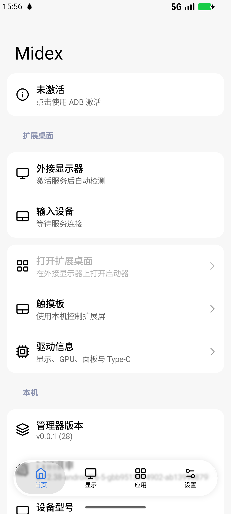
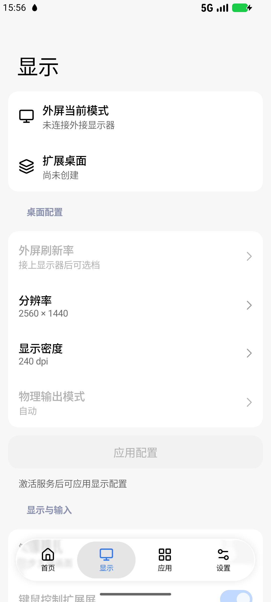
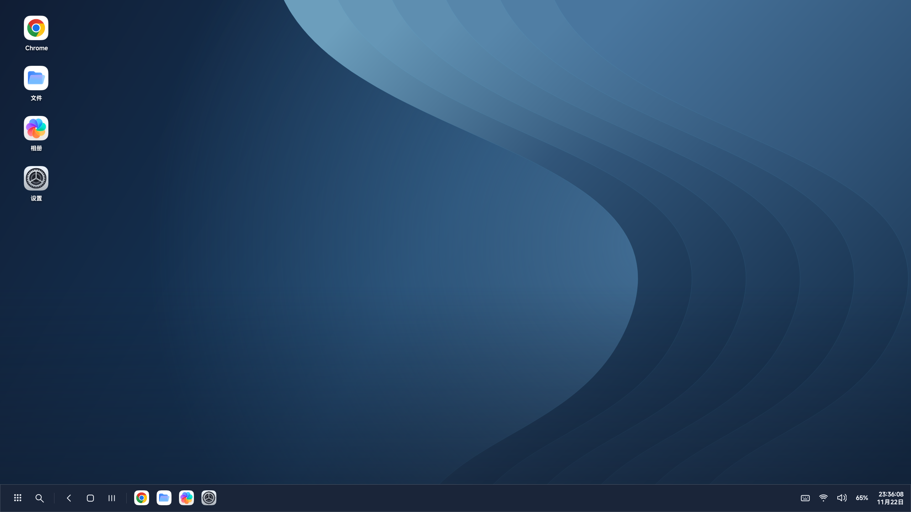

# Midex

Midex 为支持 USB-C 视频输出的 Android 手机和平板提供独立的扩展桌面。外屏可以使用自己的任务栏、应用抽屉和自由窗口，手机也可以充当触摸板和键盘。项目原名 ExtBridge。

[下载 Midex 0.0.1](https://github.com/liang1228/Midex/releases/tag/v0.0.1) · [GitHub Actions 构建记录](https://github.com/liang1228/Midex/actions/workflows/build-apk.yml) · [测试报告和原始数据](docs/testing/README.md)

## 截图

<table>
  <tr>
    <th>手机控制台</th>
    <th>显示设置</th>
  </tr>
  <tr>
    <td></td>
    <td></td>
  </tr>
</table>

控制台截图来自运行 Midex 0.0.1 的 Android 模拟器。下图来自小米 15 Ultra 四通道 DP 直连预览试验的第 189 秒。



## 安装和使用

1. 在 Android 13 或更新版本的 ARM64 设备上安装 APK。用支持视频输出的 USB-C 接口和线材接入显示器。
2. 在 Midex 首页点「使用 ADB 激活」，按提示打开 Android 的「无线调试」并配对。已有 Root 的设备也可以在「设置」选择 Root 模式后点「Root 一键激活」。
3. 接上外屏后，在「显示」选择分辨率、显示密度和刷新率，再点「应用配置」。打开扩展桌面后，可以接键鼠或使用手机触摸板。
4. 可选的开机启动、显示和窗口扩展需要 Root，具体可用选项以应用回读的权限和固件状态为准。 [Root 与 LSPosed 指南](docs/ROOT-LSPOSED.md)

GitHub 构建采用 Midex 专用签名。从旧签名的 ExtBridge 安装迁移到 GitHub APK 时，需要备份应用数据并卸载旧版后重新安装。用于原地更新的本地构建可沿用原签名。

## 验证结果

| 验证项 | 条件 | 结果 |
| --- | --- | --- |
| Midex 0.0.1 控制台 | Android 模拟器 | 安装和启动成功，首页显示新名称和版本，显示设置可打开 |
| 显示相关回归 | JDK 21 | 92 项通过，覆盖模式回读、桌面切换、模式守卫和 Root 扩展状态判定 |
| 2K 180 Hz 外屏 | 小米 15 Ultra、HyperOS 4.0.3.0、USB-C 转 DP 四通道直连、单次开机预览 | 约 192 秒内 316 次物理时序采样均为 179.99960 Hz。SurfaceFlinger 与扩展桌面保持 180 Hz，测试者确认画面清楚、无黑屏 |
| 试验回退 | 同一台手机及显示链路 | 恢复系统策略后，外屏和扩展桌面回到 120 Hz |

180 Hz 结果依赖单次开机预览及临时系统设置。0.0.1 APK 单独安装、长期运行与重启后的 180 Hz 输出仍待验证。 [真机记录](docs/testing/README.md#小米-15-ultra-直连试验)

## 从源码构建

需要 JDK 21、Android SDK Platform 37.0 和 Build Tools 36.1.0。

```bash
bash tools/test-display.sh
bash build_linux.sh
```

Windows 上运行 `./build_v3.ps1`。本地输出为 `build/out/exthelper.apk`，GitHub Actions 提供按版本命名的 APK、SHA-256 文件及签名验证结果。要沿用已有本地签名，使用 `EXTBRIDGE_KEYSTORE` 和 `EXTBRIDGE_KEYSTORE_PASS`。

项目采用 [MIT 许可](LICENSE)。第三方组件及许可见 [NOTICE](helper/assets/licenses/NOTICE)。
