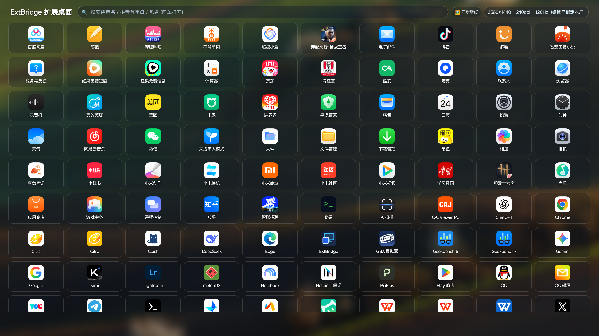
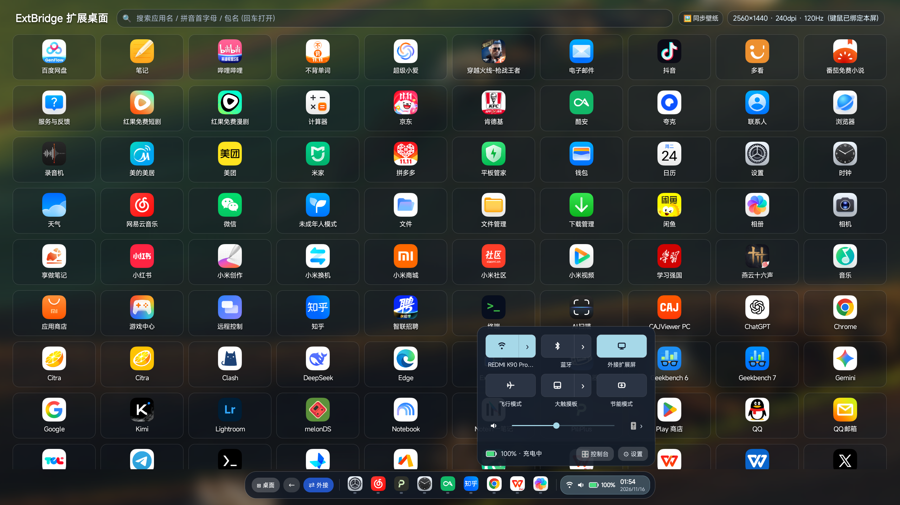
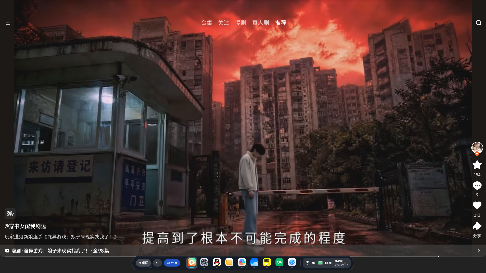
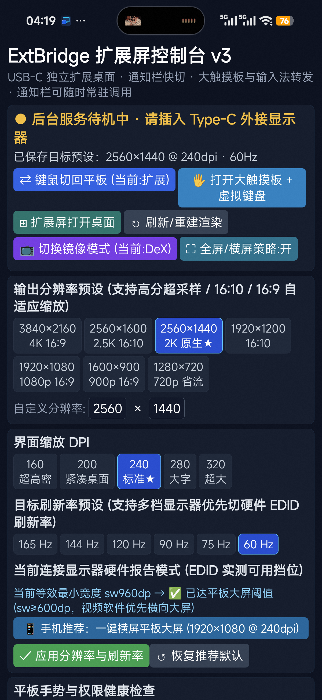
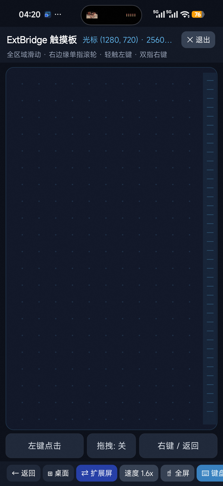

# ExtBridge — Android 免 Root Type-C 类 DeX 独立扩展桌面系统

> **无需 Root · 只需单个 APK（内置无线调试自激活）· 让支持 DP Alt Mode 的 Android 手机 / 平板插上 Type-C 显示器即刻拥有独立的 PC 级扩展桌面。**

许多 Android 设备（如小米 / REDMI 手机与平板在 HyperOS 下）默认仅对外接显示器提供**屏幕镜像（Mirroring）**，主屏和副屏画面完全一致、比例受限且无法独立操作。**ExtBridge** 通过 Shell 权限守护进程接管外接物理显示屏，在其上呈现一个独立分辨率/DPI/刷新率的 VirtualDisplay，并搭配完整的桌面启动器、底部 Dock 任务栏、快捷控制面板、硬件光标映射、虚拟触摸板与分应用显示模式管理，实现接近 Samsung DeX 的双屏独立办公与娱乐体验。

---

## 🧩 本分支新增：Root / LSPosed / 驱动信息 / Miuix UI

这是面向本机（Xiaomi Pad / `violin` / XRING O1 / Android 17）适配的增强分支，保留原版免 Root 路径，同时增加：

- **Root 模式**：App 内一键 `su` 启动 `app_process` 守护进程，不依赖无线调试；支持安装 `/data/adb/service.d` 开机自启脚本（LSPosed 接管时会自动跳过）。
- **LSPosed 系统框架模式**：同一个 APK 带 `xposed_init`，启用模块并勾选「系统框架」后把桥接逻辑注入 `system_server`，驱动读取走系统权限；不需要每次开机重新拉起守护进程。
- **本机驱动信息采集**：新增 `com.extbridge.probe.DriverProbe`，root / system_server 下采集 DRM 连接器与 EDID、DisplayManager、GPU（Mali/KGSL）、DSI 面板/背光、输入设备、Type-C/PD、USB、debugfs、dmesg 等，输出稳定 JSON，可保存或分享。
- **新控制台 UI**：KernelSU / Miuix 风格的图标导航、分组卡片、大标题、Material You 浅蓝强调色、底部悬浮玻璃导航（`GlassDrawable` + `LiquidBackgroundView`），并修掉了旧版超宽屏下卡片拥挤/文字裁切的问题。
- **Linux/ARM64 本机构建**：`build_linux.sh` 不依赖 Gradle，使用 aapt2 + d8 + apksigner 直接产出可安装 APK。

### 本机实测环境

| 项 | 值 |
|---|---|
| 设备 | Xiaomi `25053RP5CC` / `violin` / `XiaoMi Xring_o1 O81A PAD` |
| SoC | XRING O1（Mali-G925-Immortalis） |
| 系统 | Android 17 / API 37 / HyperOS 4.0 |
| 内屏 | 3200×2136，400dpi，144Hz |
| 外接 | DP Alt Mode，2560×1440@60Hz（本次测试） |
| Root | KernelSU（`u:r:ksu:s0`） |
| LSPosed | v2.2.1（Zygisk 模式，已安装） |

Root 模式下外接屏接管、VirtualDisplay 创建与输入注入均已在本机实测。

### 构建（Linux / ARM64，无 Gradle）

需要 JDK 17+ 和 Android SDK build-tools（`aapt2`、`d8`、`apksigner`、`zipalign`）：

```bash
export ANDROID_HOME=/path/to/android-sdk
./build_linux.sh
# 产物: build/out/exthelper.apk  build/out/extbridge.jar
```

官方 build-tools 的 `aapt2` 是 x86_64；在 ARM64 设备上可用 qemu 运行：

```bash
AAPT2_SYSROOT=/root/x86_64-root ./build_linux.sh
```

签名默认使用仓库根目录的 `exthelper.p12`（可选），否则自动使用 `.extbridge-debug.keystore`。**不要把私钥提交到仓库。**

### Root 激活

1. 安装 APK，打开控制台。
2. 点「Root 一键激活」，在 KernelSU / Magisk 弹窗里允许。
3. 成功后在「驱动」页可采集本机驱动信息；在「设置」里可开启 Root 开机自启。
4. 也可手动执行：

```bash
CLASSPATH=/data/local/tmp/extbridge.jar app_process /data/local/tmp com.extbridge.daemon.ExtBridge
# 只采集驱动信息：
CLASSPATH=/data/local/tmp/extbridge.jar app_process /data/local/tmp com.extbridge.daemon.ExtBridge probe
```

### LSPosed 模式

1. 安装 APK（它同时是 LSPosed 模块，`assets/xposed_init` 已内置）。
2. LSPosed 管理器 → 模块 → 勾选 **ExtBridge**。
3. 作用域勾选 **系统框架 (android)**，重启或软重启 system_server。
4. 回到控制台，运行模式应显示「LSPosed 系统框架模式」。
5. 紧急停用：`su -c 'mkdir -p /data/adb/extbridge && touch /data/adb/extbridge/disable_lsposed'`，然后重启。

> LSPosed 模式仍属实验性：同一套桥接代码在 `system_server` 中运行，已在本机完成编译/安装，但未做长时间稳定性压测。

### 驱动信息

控制台「驱动」页 →「采集驱动信息」，或在 root shell 执行 `ExtBridge probe` 得到 JSON。采集内容包括：

- DRM：`/sys/class/drm/card*-*` 状态、模式、EDID（厂商/产品/序列号/尺寸/首选时序）
- DisplayManager：内屏/外接屏/虚拟屏的 id、type、分辨率、刷新率
- GPU：Mali/KGSL 型号、频率、busy
- 面板与背光：DSI、device-tree model、backlight
- 输入：`/proc/bus/input/devices` 的名称/总线/能力
- Type-C：data_role / power_role / port_type / PD 版本、extcon
- debugfs / dmesg 中与显示、DPU、DSI、USB 相关的节点

### 已知限制

- 不同 OEM 的隐藏 API 与 SELinux 策略不同；本分支只在上述 Xiaomi 平板上实测。
- LSPosed 注入 `system_server` 属于高权限实验路径；若系统不稳定，先用上面的 kill switch 停用。
- UI 的悬浮玻璃底栏使用静态半透明 + 高光/阴影模拟，没有做逐帧 backdrop 采样模糊，避免在 3200×2136 上掉帧。
- `build_linux.sh` 需要 ARM64 本机的 qemu sysroot 才能跑官方 x86_64 aapt2；有原生 aarch64 aapt2 时会自动优先用原生。

---

## ✨ 核心特性

- **🖥️ 真·双屏独立扩展桌面（支持一键切换原生镜像）**
  - 自动探测物理外接显示器 (`Display.TYPE_EXTERNAL`)，在黑屏占位的物理副屏之上通过 `SurfaceControl` 投射独立的 `VirtualDisplay`（支持超采样/定制分辨率，如 `3840×2160`、`2560×1440`、`1920×1080` 与硬件 EDID 多档刷新率 `60Hz ~ 165Hz`）。
  - 随时在 **ExtBridge DeX 独立桌面** 与 **原生镜像模式** 之间一键无缝切换，适配不同使用场景。
- **🧩 分应用显示模式（告别部分应用适配崩坏）**
  - 每个应用可独立配置 4 种显示策略（配置持久化于 `/data/local/tmp/extbridge_apps.conf`，互不干扰，不篡改全局 `Settings.Global` 开关）：
    1. **跟随系统默认**（默认）：零兼容注入，确保微信、夸克、拼多多等应用保持正常比例与布局。
    2. **强制横屏全屏**：针对短剧/竖屏视频等强制锁定竖屏的 App（如红果短剧），通过 `am compat` 精准解锁横屏全屏沉浸观看。
    3. **竖屏居中兼容**：面向固定竖屏比例的电商/工具 App，防止拉伸错位。
    4. **自由小窗模式**：以桌面 Freeform 小窗尺寸启动并支持自由调节。
  - 在控制台首页可按名称/包名搜索配置或「一键全部重置」，也可在扩展桌面**长按 / 鼠标右键应用图标**即时调整。
- **🚀 高颜桌面启动器 + 悬浮 Dock 任务栏 + 快捷中心**
  - **独立扩展桌面 (`LauncherActivity`)**：实时同步设备原机壁纸与 GPU 高斯毛玻璃模糊背景，支持中文/英文包名/**拼音首字母**模糊检索（回车直达启动），图标按自定义模式显示彩色角标。
  - **自适应 Dock 与快捷面板 (`BridgeService`)**：DPI 自适应缩放的悬浮底部栏（桌面键、返回键、平板/扩展屏键鼠热切、正在运行任务快速切换），右下角呼出快捷开关面板（音量滑动条、Wi-Fi/蓝牙/设置跳转、DeX 策略与原生镜像快切）。
- **📱 手机端增强触摸板与输入法转发 (`TouchpadActivity`)**
  - 没有实体键鼠时，手机/平板变身**大面积全高触控板**：支持单指移动、轻触左键、双指右键、右侧边缘专属滚轮滑动区、拖拽锁定开关、灵敏度调节（`0.6x ~ 2.4x`），以及点击弹出软键盘并**直接将输入字符/回车/退格转发到外接屏焦点应用**。
  - 自动在平板/手机端启用原生导航手势保护，确保主屏侧滑返回与上滑回桌面不受影响。
- **⚡ 单 APK 免电脑自激活（内置 `libadb.so` + 电脑 ADB 双支持）**
  - 安装包内直接打包了 `arm64-v8a` 原生 `adb` 二进制与 `extbridge.jar`：支持通过本机 **无线调试 + mDNS 自动发现配对** 在手机内一键激活后台守护进程（自动过滤 `tun*`/`utun*` 等 VPN 虚拟网卡干扰），也支持在电脑端执行一句 `adb shell` 启动。

---

## 📸 实机效果展示

| 独立扩展桌面启动器（壁纸毛玻璃 + 拼音检索 + EDID 自适应） | 扩展屏底部 Dock 栏与快捷控制浮窗 |
| :---: | :---: |
|  |  |

| 短剧/视频应用强制横屏全屏（2560×1440 大屏满铺 + 底部 Dock） | 手机端控制台主页与大触摸板模式 |
| :---: | :---: |
|  |   |

---

## 🏗️ 整体架构与目录结构

```text
├── bridge/                                  # Shell 权限后台守护进程（app_process 启动）
│   └── src/com/extbridge/daemon/
│       └── ExtBridge.java                   # 物理屏接管、VirtualDisplay/SurfaceControl 投射、
│                                            # Binder IPC (ContentProvider 握手)、键鼠注入、分应用兼容策略
├── helper/                                  # Android 客户端 App (com.extbridge.helper)
│   ├── AndroidManifest.xml
│   ├── jniLibs/arm64-v8a/libadb.so          # 内置 arm64 adb 二进制，供免电脑无线调试自激活使用
│   ├── res/
│   └── src/com/extbridge/helper/
│       ├── MainActivity.java                # 控制台 UI（分辨率/DPI/刷新率、分应用显示模式管理、激活引导）
│       ├── LauncherActivity.java            # 外接屏桌面启动器（壁纸同步、拼音检索、右键/长按改模式）
│       ├── TouchpadActivity.java            # 手机/平板端大触摸板与软键盘输入转发
│       ├── BridgeService.java               # 前台服务、光标悬浮层、底部 Dock、快捷控制面板
│       ├── BridgeClient.java                # Binder IPC 客户端封装
│       ├── BridgeProvider.java              # 启动阶段零延迟传递 Binder 句柄
│       ├── ControlReceiver.java             # 通知栏快捷按钮广播响应
│       ├── NavAssistService.java            # 可选无障碍手势兜底服务
│       ├── AdbBootstrap.java                # mDNS 自动发现、无线调试配对连接、守护进程拉起
│       └── AdbPairingReceiver.java          # 通知栏输入 6 位配对码快捷激活
├── docs/images/                             # 项目图文说明截图
├── build_v3.ps1                             # Windows 一键编译打包脚本（无需 Gradle，直接调 javac/d8/aapt2）
└── start_extbridge.sh                       # 手机/ADB 手动启动守护进程脚本
```

### 工作流简述

```text
  [Type-C 接入外接显示器]
            │
            ▼
  ExtBridge 守护进程 (Shell UID, app_process)
   ├─ 探测物理 Display + 查询 EDID Modes，按需切换硬件分辨率/刷新率
   ├─ 创建 VirtualDisplay + SurfaceControl 将桌面安全隔离渲染至外接屏
   ├─ 通过 ContentProvider 回传 Binder 句柄给 com.extbridge.helper
   └─ 接管外接 HID / 触摸板事件映射注入至 VirtualDisplay，并按应用包名执行兼容模式
            │
            ▼
  ExtBridge Helper App
   ├─ 主屏：控制台 (MainActivity) / 通知栏快捷控制 / 大触摸板 (TouchpadActivity)
   └─ 外接屏：独立桌面启动器 (LauncherActivity) + 自适应 Dock & 快捷面板 (BridgeService)
```

---

## 🚀 快速上手

### 1. 环境要求
- 支持 USB-C 视频输出（DP Alt Mode）的 Android 设备（**Android 11 / API 30 及以上，建议 Android 14–16**，ARM64 架构）。
- 已在小米 HyperOS 设备（**REDMI K Pad**、**REDMI K90 Pro** 等）实测可用；其他品牌机型因系统 Hidden API 差异，部分兼容性策略效果可能有所不同。
- 安装后建议授予：**悬浮窗权限**（显示扩展屏桌面 Dock 与光标）、**允许后台运行 / 电池无限制**、**通知权限**（快捷控制与无线调试快捷配对）。

### 2. 安装与激活后台守护进程
安装编译好的 `exthelper.apk` 后，守护进程会在系统重启后失效，需要通过 **ADB Shell** 激活一次（二选一）：

#### 方式 A：免电脑，App 内本机无线调试激活
1. 打开 **设置 → 开发者选项 → 无线调试**，开启无线调试。
2. 打开 **ExtBridge**，点击弹窗中的「发送快捷配对通知」或在「使用配对码配对设备」查看 **端口与 6 位配对码**。
3. 回 App 填写配对码并点击 **「配对并激活」**（若之前已配对，可直接点 **「已配对·直接连接」**）。
> 提示：若设备开有 VPN，ExtBridge 已自动跳过 `tun*` 虚拟网卡并优先锁定物理局域网 `wlan0` IP。

#### 方式 B：电脑端 ADB 一键拉起
连接电脑后执行控制台弹窗中给出的一键命令即可（若同时连了多台设备，请加上 `adb -s <设备序列号>`）：
```bash
adb shell "(pm path com.extbridge.helper | head -n1 | cut -d: -f2; echo assets/extbridge.jar) | xargs unzip -p > /data/local/tmp/extbridge.jar && chmod 644 /data/local/tmp/extbridge.jar && appops set com.extbridge.helper SYSTEM_ALERT_WINDOW allow && appops set com.extbridge.helper RUN_ANY_IN_BACKGROUND allow && pkill -f '^app_process.*ExtBridge' 2>/dev/null; sleep 0.2; CLASSPATH=/data/local/tmp/extbridge.jar nohup app_process /data/local/tmp com.extbridge.daemon.ExtBridge >/data/local/tmp/extbridge.log 2>&1 </dev/null &"
```

### 3. 连接显示器并优化体验
1. 通过 Type-C 线或扩展坞连接显示器，外接屏会自动弹出 **ExtBridge 扩展桌面**。
2. 手机作为信号源使用时，推荐在控制台点击 **「手机推荐：一键横屏平板大屏」**（例如 `1920×1080 @ 240dpi`，可使等效 `smallestWidth` 达到 `sw800dp` 触发 App 平板横屏布局）。
3. 若发现个别应用显示错位（或无法横屏全屏）：
   - 进入控制台 **「🧩 分应用显示模式」** 或在桌面 **长按 / 右键点击图标**，按需切换「跟随系统默认 / 强制横屏全屏 / 竖屏居中兼容 / 自由小窗模式」。
   - **微信、夸克、拼多多** 等推荐保持 **「跟随系统默认」**；**红果短剧** 等默认预置为 **「强制横屏全屏」**。

---

## 🛠️ 从源码编译

本项目不依赖 Gradle 庞大的构建环境，Windows 下只需 **JDK 17+** 与 **Android SDK (`build-tools` + `platforms/android-30+`)** 即可秒级编译打包：

```powershell
# 自动查找本地 JAVA_HOME 与 ANDROID_HOME，输出至 build\out\exthelper.apk 与 extbridge.jar
powershell -ExecutionPolicy Bypass -File .\build_v3.ps1
```

- 脚本会自动从 `helper/jniLibs/arm64-v8a/libadb.so` 与编译出的 `extbridge.jar` 打入 `exthelper.apk`。
- 若仓库根目录下不存在私有的 `exthelper.p12`（亦可通过环境变量 `$env:EXTBRIDGE_KEYSTORE` 指定），脚本会自动在 `build\debug.keystore` 生成测试签名完成 APK 签名。

---

## ⚠️ 注意事项与免责声明
- 本项目使用非公开 Android 系统 API（通过 shell 权限 `app_process` 进程注入 `DisplayManager` / `SurfaceControl` / `ActivityTaskManager` / `am compat`），**不会破坏系统分区**，但不同系统版本或魔改 ROM 可能存在兼容性差异。
- `am compat` 的自定义覆盖会写入系统用户策略，如需彻底清除所有历史兼容覆盖，可在 App「分应用显示模式」内点击 **「↺ 全部重置为默认」**，或在电脑执行 `adb shell am compat reset-all <packageName>`。
- 基于 [MIT License](LICENSE) 开源。
